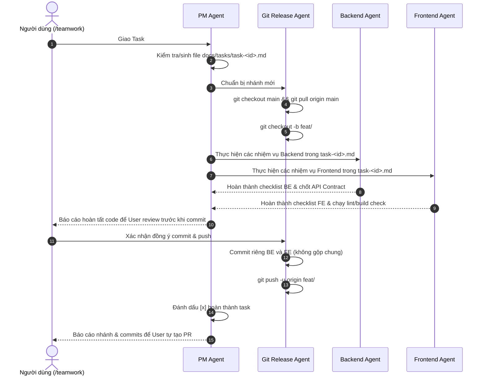

# Teamwork Multi-Agent Coordination Skill

Skill này quy định cơ chế phối hợp giữa các Agents trong dự án Social Travel Booking Monorepo (`apps/api`, `apps/web`, `apps/mobile`, `packages/*`). Việc kiểm thử tự động toàn diện do **GitHub Actions CI** đảm nhiệm khi User mở Pull Request, nên team tập trung tinh gọn vào **4 vai trò**.

---

## 1. Ma trận Phân vai (4 Roles)

| Tác tử (Agent)              | Tài liệu đặc tả quy trình                    | Phạm vi & Trách nhiệm chính                                                                                                                                                                                              |
| :-------------------------- | :------------------------------------------- | :----------------------------------------------------------------------------------------------------------------------------------------------------------------------------------------------------------------------- |
| **PM Agent (Orchestrator)** | [pm-spec.md](./pm-spec.md)                   | Sinh/cập nhật file đặc tả task tại `docs/tasks/task-<id>.md`; điều phối BE & FE; đánh dấu `[x]` hoàn thành khi task đã được push.                                                                                        |
| **Git Release Agent**       | [git-release-spec.md](./git-release-spec.md) | Trước khi code: `pull main` và tạo nhánh `feat/#<id>-...`. Sau khi code xong: **chờ User review trước**, khi User duyệt mới commit **tách riêng BE và FE**, rồi `push` nhánh lên remote (KHÔNG tạo PR, KHÔNG đóng task). |
| **Backend Agent (BE)**      | [backend-spec.md](./backend-spec.md)         | Đọc quy chuẩn dự án (`docs/coding-conventions.md`, `docs/database/schema.md`, `docs/media-storage.md`, `docs/api-spec/README.md`) và thực hiện lần lượt checklist BE trong `docs/tasks/task-<id>.md`.                    |
| **Frontend Agent (FE)**     | [frontend-spec.md](./frontend-spec.md)       | Đọc quy chuẩn dự án (`docs/coding-conventions.md`, `docs/design-system.md`, `.agent/skills/ui-design/SKILL.md`) và thực hiện lần lượt checklist Web/Mobile trong `docs/tasks/task-<id>.md`.                              |

---

## 2. Quy trình Phối hợp Chuẩn (5 Bước)

---

## 3. Nguyên tắc Bắt buộc

1. **Đọc tài liệu dự án trước khi làm:** Mọi Agent phải đọc các tài liệu quy chuẩn tương ứng được liệt kê trong file `*-spec.md` của mình trước khi chỉnh sửa code.
2. **Không tự tạo PR hay đóng Issue:** User là người kiểm thử cuối cùng, tự tạo Pull Request để GitHub Actions CI chạy kiểm thử và tự quyết định đóng task.
3. **Commit gọn theo tầng:** Luôn tách riêng commit của Backend (`apps/api`) và Frontend (`apps/web`, `apps/mobile`) để dễ review và rollback.
