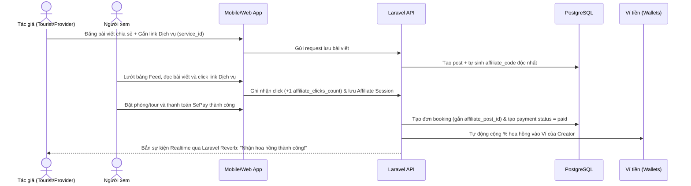
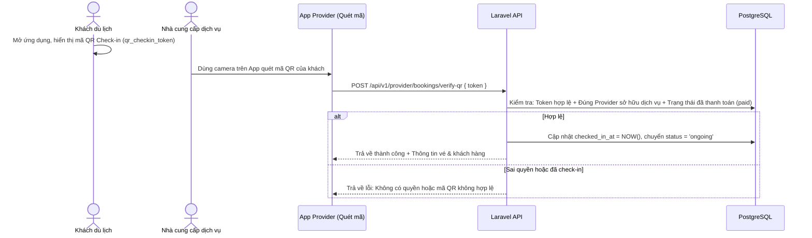

# Database Schema - Social Travel Booking

Tài liệu thiết kế và đặc tả chi tiết Cơ sở dữ liệu cho dự án **Social Travel Booking** (Web & Mobile App), kết hợp giữa **Đặt dịch vụ du lịch (Travel Booking)** và **Mạng xã hội trải nghiệm (Social Travel Network)**.

---

## 1. Nguyên tắc Thiết kế Cốt lõi

1. **Tách biệt Hồ sơ Đặt chỗ & Mạng xã hội:**
   - `tourist_profiles`: Chứa thông tin pháp lý/định danh thật (họ tên, SĐT, CCCD/hộ chiếu, ngày sinh) để phục vụ bảo hiểm du lịch, xuất vé và quản lý lưu trú.
   - `provider_profiles`: Thông tin pháp nhân kinh doanh (tên doanh nghiệp, giấy phép, địa chỉ đăng ký kinh doanh).
   - `social_profiles`: Hồ sơ mở, cho phép người dùng tự do sáng tạo `@username`, tên hiển thị, tiểu sử (bio), ảnh bìa, avatar mà không ảnh hưởng tới dữ liệu giao dịch booking.

2. **Tách biệt Đơn đặt chỗ (`bookings`) và Lịch sử Giao dịch (`payments`):**
   - Bảng `bookings` chỉ quản lý vòng đời đơn hàng, lịch trình, số lượng khách và mã check-in.
   - Bảng `payments` quản lý lịch sử thanh toán đa cổng (SePay, MoMo, VNPay, Ví nội bộ), lưu trọn vẹn `gateway_response` JSON để đối soát.

3. **Check-in bằng QR Token an toàn:**
   - Mỗi đơn có `qr_checkin_token` (chuỗi bảo mật 64 ký tự) dùng để tạo mã QR check-in.
   - Chỉ có Provider sở hữu dịch vụ mới có quyền quét xác thực check-in. Khi quét thành công, hệ thống cập nhật trường `checked_in_at` và chuyển trạng thái đơn sang `ongoing`.

4. **Quản lý Khách sạn / Homestay chi tiết (`hotel_room_types`):**
   - Hỗ trợ phân loại nhiều hạng phòng (Standard 2 người, Deluxe 4 người, Villa...) trong cùng một khách sạn/homestay với tồn kho (`inventory`) và sức chứa riêng biệt.

5. **Tiếp thị Liên kết Affiliate qua Bài viết MXH:**
   - Bài viết trên mạng xã hội có thể gắn link dịch vụ (`service_id`, `affiliate_code`).
   - Khi người xem lướt feed, bấm vào link và đặt tour/phòng thành công, đơn hàng lưu `affiliate_post_id`, tự động trích hoa hồng vào `wallets` của tác giả.

---

## 2. Chi tiết các Bảng Dữ liệu

### 2.1. Phân hệ Người dùng & Hồ sơ (Users & Profiles)

#### `users` (Tài khoản gốc)

| Cột                        | Kiểu           | Ràng buộc            | Mô tả                                     |
| :------------------------- | :------------- | :------------------- | :---------------------------------------- |
| `id`                       | `BIGINT`       | `PK, AUTO_INCREMENT` | Định danh tài khoản                       |
| `name`                     | `VARCHAR(255)` | `NOT NULL`           | Tên hiển thị mặc định                     |
| `email`                    | `VARCHAR(255)` | `UNIQUE, NOT NULL`   | Email đăng nhập                           |
| `password`                 | `VARCHAR(255)` | `NOT NULL`           | Mật khẩu mã hóa Bcrypt / Argon2           |
| `email_verified_at`        | `TIMESTAMP`    | `NULLABLE`           | Thời điểm xác thực email                  |
| `role`                     | `VARCHAR(20)`  | `DEFAULT 'tourist'`  | Vai trò: `tourist`, `provider`, `admin`   |
| `status`                   | `VARCHAR(20)`  | `DEFAULT 'active'`   | Trạng thái: `active`, `banned`, `pending` |
| `remember_token`           | `VARCHAR(100)` | `NULLABLE`           | Token ghi nhớ đăng nhập                   |
| `created_at`, `updated_at` | `TIMESTAMP`    |                      | Thời gian tạo và cập nhật                 |

#### `tourist_profiles` (Hồ sơ Khách du lịch)

| Cột                        | Kiểu           | Ràng buộc                | Mô tả                                |
| :------------------------- | :------------- | :----------------------- | :----------------------------------- |
| `id`                       | `BIGINT`       | `PK, AUTO_INCREMENT`     | Khóa chính                           |
| `user_id`                  | `BIGINT`       | `UNIQUE, FK -> users.id` | Liên kết tài khoản (1 - 1, xóa tầng) |
| `name`                     | `VARCHAR(255)` | `NULLABLE`               | Họ và tên thật (trên giấy tờ)        |
| `phone_number`             | `VARCHAR(20)`  | `NULLABLE`               | Số điện thoại liên hệ nhận vé/đơn    |
| `gender`                   | `VARCHAR(20)`  | `NULLABLE`               | Giới tính: `male`, `female`, `other` |
| `date_of_birth`            | `DATE`         | `NULLABLE`               | Ngày tháng năm sinh                  |
| `nationality`              | `VARCHAR(100)` | `NULLABLE`               | Quốc tịch                            |
| `id_card_number`           | `VARCHAR(30)`  | `NULLABLE`               | Số CCCD / Hộ chiếu                   |
| `created_at`, `updated_at` | `TIMESTAMP`    |                          | Thời gian tạo và cập nhật            |

#### `provider_profiles` (Hồ sơ Nhà cung cấp Dịch vụ)

| Cột                        | Kiểu           | Ràng buộc                | Mô tả                                              |
| :------------------------- | :------------- | :----------------------- | :------------------------------------------------- |
| `id`                       | `BIGINT`       | `PK, AUTO_INCREMENT`     | Khóa chính nhà cung cấp                            |
| `user_id`                  | `BIGINT`       | `UNIQUE, FK -> users.id` | Tài khoản đại diện doanh nghiệp                    |
| `business_name`            | `VARCHAR(255)` | `NOT NULL`               | Tên thương mại công ty / cơ sở                     |
| `business_type`            | `VARCHAR(100)` | `NULLABLE`               | Loại hình: Khách sạn, Tour du lịch, Cho thuê xe... |
| `address`                  | `TEXT`         | `NULLABLE`               | Địa chỉ văn phòng / cơ sở kinh doanh               |
| `phone`                    | `VARCHAR(20)`  | `NULLABLE`               | Hotline hỗ trợ khách hàng                          |
| `description`              | `TEXT`         | `NULLABLE`               | Giới thiệu doanh nghiệp                            |
| `status`                   | `VARCHAR(30)`  | `DEFAULT 'pending'`      | `pending`, `approved`, `rejected`, `suspended`     |
| `rejection_reason`         | `TEXT`         | `NULLABLE`               | Lý do từ chối kiểm duyệt                           |
| `approved_by`              | `BIGINT`       | `FK -> users.id`         | Admin phê duyệt                                    |
| `approved_at`              | `TIMESTAMP`    | `NULLABLE`               | Thời điểm phê duyệt                                |
| `created_at`, `updated_at` | `TIMESTAMP`    |                          | Thời gian tạo và cập nhật                          |

#### `social_profiles` (Hồ sơ Mạng xã hội Cá nhân)

| Cột                        | Kiểu           | Ràng buộc                | Mô tả                                     |
| :------------------------- | :------------- | :----------------------- | :---------------------------------------- |
| `id`                       | `BIGINT`       | `PK, AUTO_INCREMENT`     | Khóa chính                                |
| `user_id`                  | `BIGINT`       | `UNIQUE, FK -> users.id` | Liên kết tài khoản (1 - 1, xóa tầng)      |
| `username`                 | `VARCHAR(50)`  | `UNIQUE, NOT NULL`       | Định danh `@username` độc nhất            |
| `display_name`             | `VARCHAR(100)` | `NULLABLE`               | Tên hiển thị MXH tùy biến                 |
| `bio`                      | `TEXT`         | `NULLABLE`               | Tiểu sử cá nhân, châm ngôn du lịch        |
| `avatar_url`               | `TEXT`         | `NULLABLE`               | Ảnh đại diện MXH                          |
| `cover_photo_url`          | `TEXT`         | `NULLABLE`               | Ảnh bìa trang cá nhân                     |
| `website_url`              | `VARCHAR(255)` | `NULLABLE`               | Đường dẫn liên kết bên ngoài / portfolio  |
| `is_verified`              | `BOOLEAN`      | `DEFAULT FALSE`          | Tích xanh xác minh (KOLs, Travel Blogger) |
| `followers_count`          | `INTEGER`      | `DEFAULT 0`              | Số người theo dõi (counter cache)         |
| `following_count`          | `INTEGER`      | `DEFAULT 0`              | Số người đang theo dõi (counter cache)    |
| `posts_count`              | `INTEGER`      | `DEFAULT 0`              | Tổng số bài viết đã đăng (counter cache)  |
| `created_at`, `updated_at` | `TIMESTAMP`    |                          | Thời gian tạo và cập nhật                 |

---

### 2.2. Phân hệ Địa điểm & Dịch vụ (Locations & Services)

#### `locations` (Địa phương / Tỉnh thành du lịch)

| Cột                        | Kiểu           | Ràng buộc            | Mô tả                                  |
| :------------------------- | :------------- | :------------------- | :------------------------------------- |
| `id`                       | `BIGINT`       | `PK, AUTO_INCREMENT` | Khóa chính                             |
| `name`                     | `VARCHAR(255)` | `NOT NULL`           | Tên địa phương (VD: Đà Nẵng, Phú Quốc) |
| `slug`                     | `VARCHAR(255)` | `UNIQUE, NOT NULL`   | Đường dẫn thân thiện SEO               |
| `parent_id`                | `BIGINT`       | `FK -> locations.id` | Cấp cha (Quận/Huyện trỏ về Tỉnh/TP)    |
| `image_url`                | `TEXT`         | `NULLABLE`           | Ảnh banner đại diện địa phương         |
| `country_code`             | `VARCHAR(10)`  | `DEFAULT 'VN'`       | Mã quốc gia                            |
| `description`              | `TEXT`         | `NULLABLE`           | Mô tả cẩm nang địa danh                |
| `is_popular`               | `BOOLEAN`      | `DEFAULT FALSE`      | Địa điểm du lịch nổi bật               |
| `created_at`, `updated_at` | `TIMESTAMP`    |                      | Thời gian tạo và cập nhật              |

#### `categories` (Danh mục dịch vụ)

| Cột                        | Kiểu           | Ràng buộc            | Mô tả                                              |
| :------------------------- | :------------- | :------------------- | :------------------------------------------------- |
| `id`                       | `BIGINT`       | `PK, AUTO_INCREMENT` | Khóa chính                                         |
| `name`                     | `VARCHAR(255)` | `NOT NULL`           | Tên danh mục (Tour biển đảo, Homestay view núi...) |
| `slug`                     | `VARCHAR(255)` | `UNIQUE, NOT NULL`   | Đường dẫn thân thiện                               |
| `icon`                     | `VARCHAR(100)` | `NULLABLE`           | Tên icon Lucide/Material                           |
| `icon_url`                 | `TEXT`         | `NULLABLE`           | Hình ảnh icon tùy biến                             |
| `description`              | `TEXT`         | `NULLABLE`           | Mô tả danh mục                                     |
| `created_at`, `updated_at` | `TIMESTAMP`    |                      | Thời gian tạo và cập nhật                          |

#### `services` (Sản phẩm dịch vụ du lịch)

| Cột                                      | Kiểu            | Ràng buộc                    | Mô tả                                           |
| :--------------------------------------- | :-------------- | :--------------------------- | :---------------------------------------------- |
| `id`                                     | `BIGINT`        | `PK, AUTO_INCREMENT`         | Khóa chính dịch vụ                              |
| `provider_id`                            | `BIGINT`        | `FK -> provider_profiles.id` | Đơn vị cung cấp                                 |
| `category_id`                            | `BIGINT`        | `FK -> categories.id`        | Danh mục dịch vụ                                |
| `location_id`                            | `BIGINT`        | `FK -> locations.id`         | Điểm đến                                        |
| `name`                                   | `VARCHAR(255)`  | `NOT NULL`                   | Tiêu đề tour / tên khách sạn                    |
| `slug`                                   | `VARCHAR(255)`  | `UNIQUE, NOT NULL`           | Đường dẫn dịch vụ                               |
| `description`                            | `TEXT`          | `NULLABLE`                   | Bài viết giới thiệu chi tiết                    |
| `type`                                   | `VARCHAR(30)`   | `DEFAULT 'tour'`             | `tour`, `hotel`, `homestay`, `vehicle`          |
| `status`                                 | `VARCHAR(30)`   | `DEFAULT 'draft'`            | `draft`, `pending_review`, `active`, `rejected` |
| `base_price`                             | `DECIMAL(15,2)` | `NOT NULL`                   | Giá niêm yết cơ sở                              |
| `price_unit`                             | `VARCHAR(50)`   | `DEFAULT 'người'`            | Đơn vị: `người`, `phòng/đêm`, `ngày`, `xe`      |
| `max_guests`                             | `INTEGER`       | `DEFAULT 1`                  | Sức chứa tối đa                                 |
| `duration_days`                          | `INTEGER`       | `DEFAULT 1`                  | Số ngày                                         |
| `duration_nights`                        | `INTEGER`       | `DEFAULT 0`                  | Số đêm                                          |
| `address`                                | `TEXT`          | `NULLABLE`                   | Địa chỉ cụ thể                                  |
| `latitude`, `longitude`                  | `DECIMAL(10,7)` | `NULLABLE`                   | Tọa độ GPS                                      |
| `amenities`                              | `JSON`          | `NULLABLE`                   | Danh sách tiện nghi (Wifi, Hồ bơi, Bữa sáng...) |
| `includes`                               | `JSON`          | `NULLABLE`                   | Điều khoản đã bao gồm                           |
| `excludes`                               | `JSON`          | `NULLABLE`                   | Điều khoản không bao gồm                        |
| `rating_avg`                             | `DECIMAL(3,2)`  | `DEFAULT 0.00`               | Điểm đánh giá trung bình (1.00 - 5.00)          |
| `total_bookings`                         | `INTEGER`       | `DEFAULT 0`                  | Tổng lượt đặt thành công                        |
| `rejection_reason`                       | `TEXT`          | `NULLABLE`                   | Lý do kiểm duyệt từ chối                        |
| `created_at`, `updated_at`, `deleted_at` | `TIMESTAMP`     |                              | Quản lý thời gian & Soft delete                 |

#### `service_media` (Thư viện media dịch vụ)

| Cột                        | Kiểu          | Ràng buộc            | Mô tả                          |
| :------------------------- | :------------ | :------------------- | :----------------------------- |
| `id`                       | `BIGINT`      | `PK, AUTO_INCREMENT` | Khóa chính                     |
| `service_id`               | `BIGINT`      | `FK -> services.id`  | Thuộc dịch vụ nào              |
| `url`                      | `TEXT`        | `NOT NULL`           | URL ảnh / video trên CDN       |
| `type`                     | `VARCHAR(20)` | `DEFAULT 'image'`    | `image` hoặc `video`           |
| `is_cover`                 | `BOOLEAN`     | `DEFAULT FALSE`      | Là ảnh bìa hiển thị ngoài card |
| `sort_order`               | `SMALLINT`    | `DEFAULT 0`          | Thứ tự hiển thị trong slider   |
| `created_at`, `updated_at` | `TIMESTAMP`   |                      | Thời gian tạo và cập nhật      |

#### `service_schedules` (Lịch trình Tour từng ngày)

| Cột                        | Kiểu           | Ràng buộc            | Mô tả                                               |
| :------------------------- | :------------- | :------------------- | :-------------------------------------------------- |
| `id`                       | `BIGINT`       | `PK, AUTO_INCREMENT` | Khóa chính                                          |
| `service_id`               | `BIGINT`       | `FK -> services.id`  | Thuộc tour nào                                      |
| `day_number`               | `INTEGER`      | `NOT NULL`           | Ngày thứ N của hành trình (1, 2, 3...)              |
| `title`                    | `VARCHAR(255)` | `NOT NULL`           | Tiêu đề ngày (VD: "Đón sân bay - Khám phá Sơn Trà") |
| `description`              | `TEXT`         | `NULLABLE`           | Tóm tắt lịch trình                                  |
| `activities`               | `JSON`         | `NULLABLE`           | Mảng chi tiết: mốc giờ, địa điểm ghé thăm, ăn uống  |
| `created_at`, `updated_at` | `TIMESTAMP`    |                      | Thời gian tạo và cập nhật                           |

#### `hotel_room_types` (Phân loại phòng Khách sạn / Homestay)

| Cột                        | Kiểu            | Ràng buộc            | Mô tả                                                     |
| :------------------------- | :-------------- | :------------------- | :-------------------------------------------------------- |
| `id`                       | `BIGINT`        | `PK, AUTO_INCREMENT` | Khóa chính loại phòng                                     |
| `service_id`               | `BIGINT`        | `FK -> services.id`  | Thuộc khách sạn / homestay nào                            |
| `name`                     | `VARCHAR(255)`  | `NOT NULL`           | Tên phòng (VD: Phòng Superior Giường Đôi, Căn hộ 4 khách) |
| `rank`                     | `VARCHAR(100)`  | `DEFAULT 'standard'` | Hạng phòng (`standard`, `deluxe`, `suite`, `vip`)         |
| `description`              | `TEXT`          | `NULLABLE`           | Mô tả tiện ích loại phòng                                 |
| `base_price`               | `DECIMAL(15,2)` | `NOT NULL`           | Giá phòng mỗi đêm                                         |
| `total_rooms`              | `INTEGER`       | `DEFAULT 1`          | Tổng số lượng phòng thuộc loại này                        |
| `inventory`                | `INTEGER`       | `DEFAULT 1`          | Số lượng phòng sẵn sàng đón khách                         |
| `capacity_adults`          | `INTEGER`       | `DEFAULT 2`          | Số lượng người lớn tối đa                                 |
| `capacity_children`        | `INTEGER`       | `DEFAULT 0`          | Số lượng trẻ em tối đa                                    |
| `amenities`                | `JSON`          | `NULLABLE`           | Tiện ích riêng của phòng (Bồn tắm, Ban công, Tủ lạnh...)  |
| `images`                   | `JSON`          | `NULLABLE`           | Mảng URL ảnh của loại phòng này                           |
| `status`                   | `VARCHAR(30)`   | `DEFAULT 'active'`   | `active`, `inactive`                                      |
| `created_at`, `updated_at` | `TIMESTAMP`     |                      | Thời gian tạo và cập nhật                                 |

#### `service_availability` (Lịch khả dụng & Giá theo ngày)

| Cột                        | Kiểu            | Ràng buộc            | Mô tả                                      |
| :------------------------- | :-------------- | :------------------- | :----------------------------------------- |
| `id`                       | `BIGINT`        | `PK, AUTO_INCREMENT` | Khóa chính                                 |
| `service_id`               | `BIGINT`        | `FK -> services.id`  | Dịch vụ tương ứng                          |
| `available_date`           | `DATE`          | `NOT NULL`           | Ngày cụ thể áp dụng                        |
| `total_slots`              | `INTEGER`       | `DEFAULT 0`          | Tổng số chỗ/phòng mở bán trong ngày        |
| `booked_slots`             | `INTEGER`       | `DEFAULT 0`          | Số chỗ/phòng đã được đặt                   |
| `price_override`           | `DECIMAL(15,2)` | `NULLABLE`           | Giá đặc biệt áp dụng cho ngày lễ/cuối tuần |
| `is_blocked`               | `BOOLEAN`       | `DEFAULT FALSE`      | Khóa tạm thời không nhận khách trong ngày  |
| `created_at`, `updated_at` | `TIMESTAMP`     |                      | Thời gian tạo và cập nhật                  |

---

### 2.3. Phân hệ Đặt chỗ, Thanh toán & Ví tiền (Bookings, Payments & Wallets)

#### `bookings` (Đơn đặt chỗ du lịch)

| Cột                        | Kiểu            | Ràng buộc                    | Mô tả                                                                        |
| :------------------------- | :-------------- | :--------------------------- | :--------------------------------------------------------------------------- |
| `id`                       | `BIGINT`        | `PK, AUTO_INCREMENT`         | Khóa chính đơn đặt                                                           |
| `booking_code`             | `VARCHAR(20)`   | `UNIQUE, NOT NULL`           | Mã hiển thị thân thiện (VD: `STB-20261019-ABCD`)                             |
| `qr_checkin_token`         | `VARCHAR(64)`   | `UNIQUE, NOT NULL`           | Token bảo mật ngẫu nhiên dùng render mã QR check-in                          |
| `user_id`                  | `BIGINT`        | `FK -> users.id`             | Người đặt tour/phòng                                                         |
| `service_id`               | `BIGINT`        | `FK -> services.id`          | Dịch vụ được đặt                                                             |
| `provider_id`              | `BIGINT`        | `FK -> provider_profiles.id` | Nhà cung cấp thụ hưởng                                                       |
| `room_type_id`             | `BIGINT`        | `FK -> hotel_room_types.id`  | Loại phòng được chọn (nếu là Hotel/Homestay, `NULL` nếu là Tour)             |
| `coupon_id`                | `BIGINT`        | `FK -> coupons.id`           | Mã giảm giá đã áp dụng                                                       |
| `affiliate_post_id`        | `BIGINT`        | `FK -> posts.id`             | Bài viết MXH dẫn đến đơn này (tính hoa hồng)                                 |
| `check_in_date`            | `DATE`          | `NOT NULL`                   | Ngày bắt đầu tour / nhận phòng                                               |
| `check_out_date`           | `DATE`          | `NULLABLE`                   | Ngày kết thúc tour / trả phòng                                               |
| `checked_in_at`            | `TIMESTAMP`     | `NULLABLE`                   | Thời điểm Provider quét mã QR check-in thành công                            |
| `num_adults`               | `INTEGER`       | `DEFAULT 1`                  | Số lượng người lớn                                                           |
| `num_children`             | `INTEGER`       | `DEFAULT 0`                  | Số lượng trẻ em                                                              |
| `unit_price`               | `DECIMAL(15,2)` | `NOT NULL`                   | Đơn giá tại thời điểm đặt                                                    |
| `subtotal`                 | `DECIMAL(15,2)` | `NOT NULL`                   | Tổng tiền trước giảm giá                                                     |
| `discount_amount`          | `DECIMAL(15,2)` | `DEFAULT 0.00`               | Số tiền được giảm từ coupon                                                  |
| `coupon_code`              | `VARCHAR(50)`   | `NULLABLE`                   | Tên mã voucher áp dụng tại thời điểm đặt                                     |
| `total_amount`             | `DECIMAL(15,2)` | `NOT NULL`                   | Số tiền thực thu sau cùng                                                    |
| `status`                   | `VARCHAR(30)`   | `DEFAULT 'pending'`          | `pending` -> `paid` -> `confirmed` -> `ongoing` -> `completed` / `cancelled` |
| `contact_name`             | `VARCHAR(255)`  | `NOT NULL`                   | Tên người nhận liên hệ đón tiếp                                              |
| `contact_phone`            | `VARCHAR(20)`   | `NOT NULL`                   | Số điện thoại liên hệ                                                        |
| `contact_email`            | `VARCHAR(255)`  | `NULLABLE`                   | Email nhận vé điện tử                                                        |
| `special_requests`         | `TEXT`          | `NULLABLE`                   | Yêu cầu đặc biệt của khách                                                   |
| `cancel_reason`            | `TEXT`          | `NULLABLE`                   | Lý do hủy đơn                                                                |
| `cancelled_at`             | `TIMESTAMP`     | `NULLABLE`                   | Thời điểm hủy                                                                |
| `created_at`, `updated_at` | `TIMESTAMP`     |                              | Thời gian tạo và cập nhật đơn                                                |

#### `payments` (Lịch sử giao dịch thanh toán)

| Cột                        | Kiểu            | Ràng buộc            | Mô tả                                                          |
| :------------------------- | :-------------- | :------------------- | :------------------------------------------------------------- |
| `id`                       | `BIGINT`        | `PK, AUTO_INCREMENT` | Khóa chính giao dịch                                           |
| `booking_id`               | `BIGINT`        | `FK -> bookings.id`  | Thuộc đơn đặt chỗ nào                                          |
| `payment_method`           | `VARCHAR(30)`   | `NOT NULL`           | Cổng thanh toán: `sepay`, `momo`, `vnpay`, `wallet`, `banking` |
| `amount`                   | `DECIMAL(15,2)` | `NOT NULL`           | Số tiền giao dịch                                              |
| `currency`                 | `VARCHAR(5)`    | `DEFAULT 'VND'`      | Đơn vị tiền tệ                                                 |
| `transaction_code`         | `VARCHAR(100)`  | `NULLABLE, INDEX`    | Mã tham chiếu SePay / Mã giao dịch Ngân hàng                   |
| `status`                   | `VARCHAR(30)`   | `DEFAULT 'pending'`  | `pending`, `paid`, `failed`, `refunded`                        |
| `gateway_response`         | `JSON`          | `NULLABLE`           | Trọn vẹn payload Webhook đối soát kỹ thuật                     |
| `paid_at`                  | `TIMESTAMP`     | `NULLABLE`           | Thời điểm thanh toán thành công                                |
| `created_at`, `updated_at` | `TIMESTAMP`     |                      | Thời gian tạo và cập nhật                                      |

#### `coupons` (Mã giảm giá / Voucher)

| Cột                        | Kiểu            | Ràng buộc            | Mô tả                                                |
| :------------------------- | :-------------- | :------------------- | :--------------------------------------------------- |
| `id`                       | `BIGINT`        | `PK, AUTO_INCREMENT` | Khóa chính mã                                        |
| `code`                     | `VARCHAR(50)`   | `UNIQUE, NOT NULL`   | Chuỗi ký tự nhập (VD: `HELLOSUMMER2026`)             |
| `type`                     | `VARCHAR(20)`   | `DEFAULT 'percent'`  | Loại giảm: `percent` (%) hoặc `fixed` (tiền cố định) |
| `discount_value`           | `DECIMAL(15,2)` | `NOT NULL`           | Giá trị giảm (% hoặc số tiền VND)                    |
| `min_order_amount`         | `DECIMAL(15,2)` | `NULLABLE`           | Giá trị đơn hàng tối thiểu                           |
| `usage_limit`              | `INTEGER`       | `NULLABLE`           | Giới hạn số lượt dùng trên toàn sàn                  |
| `used_count`               | `INTEGER`       | `DEFAULT 0`          | Số lượt đã sử dụng                                   |
| `per_user_limit`           | `INTEGER`       | `DEFAULT 1`          | Số lần tối đa mỗi tài khoản được dùng                |
| `valid_from`               | `TIMESTAMP`     | `NULLABLE`           | Bắt đầu có hiệu lực                                  |
| `valid_until`              | `TIMESTAMP`     | `NULLABLE`           | Hết hạn                                              |
| `created_by`               | `BIGINT`        | `FK -> users.id`     | Người phát hành (Admin / Provider)                   |
| `created_at`, `updated_at` | `TIMESTAMP`     |                      | Thời gian tạo và cập nhật                            |

#### `wallets` (Ví điện tử tài khoản)

| Cột                        | Kiểu            | Ràng buộc                | Mô tả                                             |
| :------------------------- | :-------------- | :----------------------- | :------------------------------------------------ |
| `id`                       | `BIGINT`        | `PK, AUTO_INCREMENT`     | Khóa chính ví                                     |
| `user_id`                  | `BIGINT`        | `UNIQUE, FK -> users.id` | Chủ sở hữu ví                                     |
| `balance`                  | `DECIMAL(15,2)` | `DEFAULT 0.00`           | Số dư khả dụng hiện tại                           |
| `locked_balance`           | `DECIMAL(15,2)` | `DEFAULT 0.00`           | Số dư tạm giữ (chờ tour hoàn thành để quyết toán) |
| `currency`                 | `VARCHAR(5)`    | `DEFAULT 'VND'`          | Loại tiền tệ                                      |
| `created_at`, `updated_at` | `TIMESTAMP`     |                          | Thời gian tạo và cập nhật                         |

#### `wallet_transactions` (Lịch sử biến động số dư)

| Cột                        | Kiểu            | Ràng buộc            | Mô tả                                                                                |
| :------------------------- | :-------------- | :------------------- | :----------------------------------------------------------------------------------- |
| `id`                       | `BIGINT`        | `PK, AUTO_INCREMENT` | Khóa chính                                                                           |
| `wallet_id`                | `BIGINT`        | `FK -> wallets.id`   | Thuộc ví nào                                                                         |
| `type`                     | `VARCHAR(30)`   | `NOT NULL`           | `deposit`, `booking_payment`, `refund`, `commission`, `affiliate_reward`, `withdraw` |
| `amount`                   | `DECIMAL(15,2)` | `NOT NULL`           | Số tiền biến động (+ hoặc -)                                                         |
| `balance_before`           | `DECIMAL(15,2)` | `NOT NULL`           | Số dư trước giao dịch                                                                |
| `balance_after`            | `DECIMAL(15,2)` | `NOT NULL`           | Số dư sau giao dịch                                                                  |
| `note`                     | `VARCHAR(255)`  | `NULLABLE`           | Nội dung ghi chú biến động                                                           |
| `reference_id`             | `VARCHAR(100)`  | `NULLABLE`           | Mã đơn booking hoặc mã SePay đối chiếu                                               |
| `created_at`, `updated_at` | `TIMESTAMP`     |                      | Thời gian tạo và cập nhật                                                            |

---

### 2.4. Phân hệ Mạng xã hội Du lịch (Social Network)

#### `posts` (Bài viết chia sẻ / Quảng bá dịch vụ)

| Cột                                      | Kiểu            | Ràng buộc            | Mô tả                                                |
| :--------------------------------------- | :-------------- | :------------------- | :--------------------------------------------------- |
| `id`                                     | `BIGINT`        | `PK, AUTO_INCREMENT` | Khóa chính bài viết                                  |
| `user_id`                                | `BIGINT`        | `FK -> users.id`     | Tác giả bài viết (Tourist hoặc Provider)             |
| `content`                                | `TEXT`          | `NULLABLE`           | Nội dung văn bản chia sẻ                             |
| `location_name`                          | `VARCHAR(255)`  | `NULLABLE`           | Địa điểm check-in (VD: "Bà Nà Hills, Đà Nẵng")       |
| `latitude`, `longitude`                  | `DECIMAL(10,7)` | `NULLABLE`           | Tọa độ GPS gắn với bài viết                          |
| `service_id`                             | `BIGINT`        | `FK -> services.id`  | Dịch vụ được gắn link (**Affiliate Marketing**)      |
| `service_type`                           | `VARCHAR(50)`   | `NULLABLE`           | Loại dịch vụ: `tour`, `hotel`, `homestay`, `vehicle` |
| `affiliate_code`                         | `VARCHAR(50)`   | `NULLABLE, INDEX`    | Mã giới thiệu tự động gắn cho tác giả                |
| `visibility`                             | `VARCHAR(20)`   | `DEFAULT 'public'`   | Quyền hiển thị: `public`, `followers`, `private`     |
| `is_pinned`                              | `BOOLEAN`       | `DEFAULT FALSE`      | Ghim lên đầu trang cá nhân                           |
| `likes_count`                            | `INTEGER`       | `DEFAULT 0`          | Lượt thả tim (counter cache)                         |
| `comments_count`                         | `INTEGER`       | `DEFAULT 0`          | Lượt bình luận (counter cache)                       |
| `shares_count`                           | `INTEGER`       | `DEFAULT 0`          | Lượt chia sẻ (counter cache)                         |
| `views_count`                            | `INTEGER`       | `DEFAULT 0`          | Tổng lượt xem bài viết                               |
| `affiliate_clicks_count`                 | `INTEGER`       | `DEFAULT 0`          | Số lượt nhấp vào link dịch vụ đính kèm               |
| `created_at`, `updated_at`, `deleted_at` | `TIMESTAMP`     |                      | Quản lý thời gian & Soft delete                      |

#### `post_media` (Media bài viết: Danh sách Ảnh / Video)

| Cột                        | Kiểu          | Ràng buộc            | Mô tả                                         |
| :------------------------- | :------------ | :------------------- | :-------------------------------------------- |
| `id`                       | `BIGINT`      | `PK, AUTO_INCREMENT` | Khóa chính                                    |
| `post_id`                  | `BIGINT`      | `FK -> posts.id`     | Thuộc bài viết nào (xóa tầng)                 |
| `media_type`               | `VARCHAR(20)` | `DEFAULT 'image'`    | `image` hoặc `video`                          |
| `url`                      | `TEXT`        | `NOT NULL`           | URL ảnh / video gốc                           |
| `thumbnail_url`            | `TEXT`        | `NULLABLE`           | Ảnh thumbnail xem trước (dành cho video)      |
| `width`, `height`          | `INTEGER`     | `NULLABLE`           | Kích thước gốc để tối ưu tỷ lệ giao diện app  |
| `sort_order`               | `SMALLINT`    | `DEFAULT 0`          | Thứ tự hiển thị trong bộ sưu tập (0, 1, 2...) |
| `created_at`, `updated_at` | `TIMESTAMP`   |                      | Thời gian tạo và cập nhật                     |

#### `tags` & `post_tags` (Hệ thống Hashtags)

- **`tags`**: Lưu danh mục hashtag chủ đề du lịch.
  - `id` (`BIGINT, PK`), `name` (`VARCHAR(100), UNIQUE` - VD: `danang`), `display_name` (`VARCHAR(100)` - VD: `#ĐàNẵng`), `type` (`VARCHAR(30)` - `location`, `category`, `activity`), `posts_count` (`INTEGER`).
- **`post_tags`**: Bảng trung gian nhiều-nhiều.
  - Khóa chính kết hợp: `(post_id, tag_id)`. Xóa tầng theo bài viết hoặc tag.

#### `likes` (Lượt thả tim bài viết)

| Cột          | Kiểu        | Ràng buộc            | Mô tả                                          |
| :----------- | :---------- | :------------------- | :--------------------------------------------- |
| `id`         | `BIGINT`    | `PK, AUTO_INCREMENT` | Khóa chính                                     |
| `user_id`    | `BIGINT`    | `FK -> users.id`     | Người thả tim                                  |
| `post_id`    | `BIGINT`    | `FK -> posts.id`     | Bài viết được tim                              |
| `created_at` | `TIMESTAMP` |                      | Ràng buộc duy nhất: `UNIQUE(user_id, post_id)` |

#### `comments` (Bình luận bài viết - Hỗ trợ phân cấp lồng nhau)

| Cột                                      | Kiểu        | Ràng buộc            | Mô tả                                              |
| :--------------------------------------- | :---------- | :------------------- | :------------------------------------------------- |
| `id`                                     | `BIGINT`    | `PK, AUTO_INCREMENT` | Khóa chính                                         |
| `post_id`                                | `BIGINT`    | `FK -> posts.id`     | Bài viết được bình luận                            |
| `user_id`                                | `BIGINT`    | `FK -> users.id`     | Tác giả bình luận                                  |
| `parent_id`                              | `BIGINT`    | `FK -> comments.id`  | Bình luận cha (hỗ trợ **Nested/Threaded Replies**) |
| `content`                                | `TEXT`      | `NOT NULL`           | Nội dung bình luận                                 |
| `likes_count`                            | `INTEGER`   | `DEFAULT 0`          | Lượt thích của bình luận                           |
| `created_at`, `updated_at`, `deleted_at` | `TIMESTAMP` |                      | Hỗ trợ xóa mềm (Soft delete)                       |

#### `post_shares` (Chia sẻ bài viết)

- `id` (`BIGINT, PK`), `post_id` (`FK -> posts.id`), `user_id` (`FK -> users.id`), `platform` (`VARCHAR(50)`: `internal`, `facebook`, `zalo`, `copy_link`), `created_at`.

#### `saved_posts` (Lưu bài viết yêu thích / Bookmark)

- `id` (`BIGINT, PK`), `user_id` (`FK -> users.id`), `post_id` (`FK -> posts.id`), `created_at`. Khóa duy nhất: `UNIQUE(user_id, post_id)`.

#### `follows` (Mối quan hệ theo dõi)

- `id` (`BIGINT, PK`), `follower_id` (`FK -> users.id`), `following_id` (`FK -> users.id`), `created_at`. Ràng buộc duy nhất `UNIQUE(follower_id, following_id)`.

#### `social_notifications` (Thông báo mạng xã hội Realtime qua Laravel Reverb)

- `id` (`BIGINT, PK`), `user_id` (`FK -> users.id` - người nhận), `actor_id` (`FK -> users.id` - người tạo hành động), `type` (`VARCHAR(50)`: `like_post`, `comment_post`, `reply_comment`, `follow_user`, `affiliate_booking`), `post_id`, `comment_id`, `data` (`JSON`), `is_read` (`BOOLEAN`), `timestamps`.

---

### 2.5. Phân hệ Đánh giá Dịch vụ (Reviews)

#### `reviews` (Đánh giá sau khi hoàn thành dịch vụ)

| Cột                        | Kiểu        | Ràng buộc                   | Mô tả                                                   |
| :------------------------- | :---------- | :-------------------------- | :------------------------------------------------------ |
| `id`                       | `BIGINT`    | `PK, AUTO_INCREMENT`        | Khóa chính review                                       |
| `booking_id`               | `BIGINT`    | `UNIQUE, FK -> bookings.id` | Mỗi đơn booking chỉ được đánh giá 1 lần (xác thực thật) |
| `service_id`               | `BIGINT`    | `FK -> services.id`         | Dịch vụ được đánh giá                                   |
| `user_id`                  | `BIGINT`    | `FK -> users.id`            | Du khách đánh giá                                       |
| `rating`                   | `TINYINT`   | `NOT NULL`                  | Điểm số từ 1 đến 5 sao                                  |
| `content`                  | `TEXT`      | `NULLABLE`                  | Nội dung nhận xét chi tiết                              |
| `images`                   | `JSON`      | `NULLABLE`                  | Danh sách URL ảnh thực tế du khách tải lên              |
| `provider_reply`           | `TEXT`      | `NULLABLE`                  | Lời cảm ơn hoặc phản hồi giải trình của Provider        |
| `provider_reply_at`        | `TIMESTAMP` | `NULLABLE`                  | Thời điểm Provider phản hồi                             |
| `created_at`, `updated_at` | `TIMESTAMP` |                             | Thời gian tạo và cập nhật                               |

---

## 3. Luồng Nghiệp vụ Đặc thù

### 3.1. Cơ chế Tiếp thị liên kết (Affiliate qua Bài viết MXH)

### 3.2. Quy trình Check-in bằng Mã QR Token

